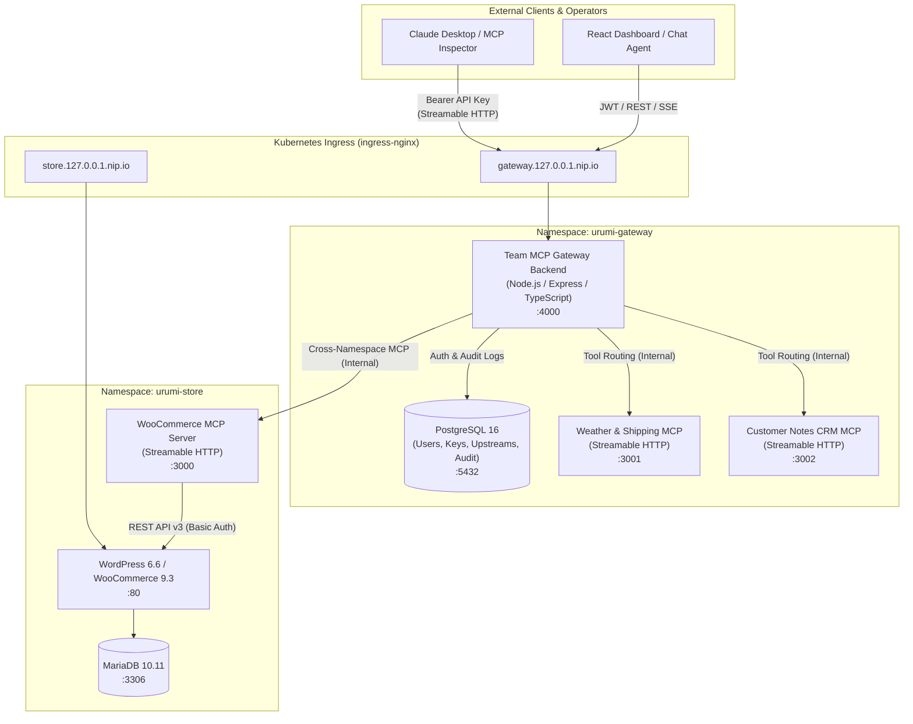

# System Design and Architectural Tradeoffs

## 1. Executive Summary

This document details the architectural design, component responsibilities, protocol specifications, security guardrails, and operational tradeoffs for the **Urumi Team MCP Gateway on Kubernetes**.

The system establishes an enterprise-grade control plane that aggregates multiple cluster-internal Model Context Protocol (MCP) servers into a single secure gateway endpoint. It provides identity management, granular role-based access control (RBAC), instant API key revocation, comprehensive audit logging in PostgreSQL, and an interactive React-based operations dashboard with an embedded LLM chat agent.

---

## 2. High-Level Architecture

The platform is deployed across two isolated Kubernetes namespaces:
- **`urumi-store`**: Contains the WordPress/WooCommerce stack, MariaDB database, and the custom WooCommerce Streamable HTTP MCP server.
- **`urumi-gateway`**: Contains the Team MCP Gateway Backend, PostgreSQL stateful storage, additional mock upstream MCP servers (Weather & Shipping, Customer CRM Notes), and the Ingress routing layer.

---

## 3. Component Deep Dive

### 3.1. Team MCP Gateway Backend
- **Single Aggregation Endpoint (`/mcp`)**: Implements official Model Context Protocol Streamable HTTP transport (`@modelcontextprotocol/sdk`). Dynamically aggregates tool definitions from all registered, healthy, and enabled upstream MCP servers.
- **Upstream Connection Manager**: Maintains persistent Streamable HTTP sessions with upstream servers. Employs independent protocol session factories per incoming client connection.
- **Fault Isolation Engine**: Wraps all upstream tool listing and execution calls in strict `AbortSignal.timeout(5000)` and `AbortSignal.timeout(8000)` boundaries. Upstream server queries run via `Promise.allSettled()`, ensuring an unreachable or degraded upstream server never impedes tool discovery or invocation for remaining servers.
- **Security & RBAC Enforcement**:
  - Authenticates incoming requests via SHA-256 hashed API keys (`ugw_live_...`) or JWT sessions.
  - Queries `revoked_at IS NULL` on every tool invocation to guarantee instant revocation without token expiration delays.
  - Role-based authorization: **Admin** (`alice@example.com`) can register, toggle, and delete upstream servers, and inspect all team audit records. **Member** (`bob@example.com`) can manage personal API keys and invoke tools through the gateway.
- **SSRF Guardrail**: Validates upstream server URLs on registration and update. Strictly prohibits loopback (`127.0.0.1`, `localhost`), link-local, cloud metadata IP (`169.254.169.254`), and Kubernetes control plane API server addresses (`10.96.0.1`, `kubernetes.default`).
- **Audit Logger**: Persists structured telemetry into PostgreSQL for every tool execution across all clients and the chat agent (`user_id`, `user_email`, `server_name`, `tool_name`, `arguments`, `status`, `duration_ms`, `error_message`, `created_at`).

### 3.2. Custom WooCommerce MCP Server
- **Protocol**: Streamable HTTP transport exposing `/mcp` and `/healthz`.
- **Exposed Tools**:
  1. `woocommerce_list_products`: Filterable product catalog retrieval with pagination guardrails.
  2. `woocommerce_get_product`: Single product lookup by integer ID.
  3. `woocommerce_create_product`: Validates product name, sanitize descriptions, and validates price formats via regex (`/^\d+(\.\d{1,2})?$/`).
  4. `woocommerce_list_orders`: Order history retrieval with customer and status filters.
  5. `woocommerce_update_order_status`: Whitelisted status updates (`pending`, `processing`, `on-hold`, `completed`, `cancelled`, `refunded`, `failed`).
- **Security Guardrails**:
  - Non-root container execution (`USER node`, uid 1000).
  - Dropped all Linux capabilities (`drop: [ALL]`).
  - Read-only root filesystem (`readOnlyRootFilesystem: true`) with memory `tmpfs` mounted at `/tmp`.
  - Upstream credentials (`WC_CONSUMER_KEY`, `WC_CONSUMER_SECRET`) injected exclusively via Kubernetes Secrets.

### 3.3. Additional Mock Upstream Servers
- **Weather & Shipping MCP Server (`weather-mcp:3001`)**:
  - `weather_get_forecast`: Weather forecasting for delivery estimations.
  - `shipping_get_rates`: Multi-tier courier pricing calculation based on destination and weight.
- **Customer Notes CRM MCP Server (`notes-mcp:3002`)**:
  - `customer_notes_save`: In-memory persistence of support notes, delivery gate codes, and VIP preferences.
  - `customer_notes_get`: History retrieval for a specific customer.
  - `customer_notes_list_recent`: Recent customer notes across accounts.

### 3.4. React Dashboard & Chat Agent
- **Stack**: React 18, Vite, Lucide Icons, and Vanilla CSS design tokens.
- **Embedded LLM Chat Agent**: Connects to the Gateway backend (`/api/chat`). Features an automatic tool-calling loop: converts unified MCP tools into LLM function declarations, invokes tools exclusively through the Gateway as the logged-in user, and renders expandable tool execution cards.
- **Unified Deployment**: Built into static production artifacts (`/app/public`) and served directly by the Gateway backend container under `/`, providing seamless same-origin communication with `/api/*` and `/mcp`.

---

## 4. Key Architectural Tradeoffs

| Decision | Chosen Approach | Alternative Considered | Rationale |
| :--- | :--- | :--- | :--- |
| **Transport Protocol** | Streamable HTTP (`/mcp` handling POST & GET) | Stdio or Legacy SSE (`/sse` + `/message`) | Streamable HTTP is the modern standard in `@modelcontextprotocol/sdk`. It supports standard HTTP proxying, session multiplexing, connection timeouts, and horizontal scaling across Kubernetes Pods. |
| **Tool Namespacing** | Deterministic Tool Naming (`woocommerce_*`, `weather_*`, `customer_notes_*`) | Dynamic Prefixing at Gateway | Clean separation of tool domains prevents collisions while keeping tool declarations predictable and natural for LLM function calling. |
| **API Key Storage** | SHA-256 Hashing with Plaintext Returned Once | Symmetric Encryption (AES-GCM) | Plaintext keys are never retrievable from the database. In the event of database compromise, API keys cannot be extracted. Instant revocation check is $O(1)$ by hashed key index. |
| **Frontend Architecture** | Integrated SPA served from Gateway Pod | Dedicated Frontend Nginx Pod | Consolidates memory and CPU usage on low-resource VPS nodes; eliminates CORS complexity; allows single Ingress rule for domain routing. |
| **Database Engine** | PostgreSQL 16 StatefulSet with PVC | In-Memory SQLite | Guarantees durable audit logs and API key storage across pod restarts and scaling events while maintaining standard SQL query capabilities. |
| **LLM Execution** | Gateway-side Tool Loop with Local Intent Fallback | Client-Side Direct LLM Connection | Zero API credentials ever reach the browser; every tool call made by the assistant is strictly audited and executed with the user's authenticated context. |

---

## 5. Fault Isolation & Resilience Strategy

1. **Decoupled Upstream Transports**: Each upstream server runs in a dedicated Pod and Deployment. A crash or restart in `weather-mcp` does not affect `woocommerce-mcp` or `notes-mcp`.
2. **Aggregator Circuit Breaker**: Tool discovery (`tools/list`) executes across upstream servers in parallel via `Promise.allSettled`. If any server is offline or fails its handshake, the error is isolated, logged as `unreachable`, and the Gateway continues serving tools from all healthy upstreams.
3. **Execution Timeouts**: All upstream tool calls are bounded by 8-second HTTP timeouts. Slow external APIs cannot exhaust Gateway worker threads.
4. **Session Isolation**: A dedicated `Server` protocol instance is instantiated per client connection, preventing cross-client state pollution or transport reuse errors.

---

## 6. Scalability & Production Readiness

- **Stateless Backend Tier**: The Gateway Backend stores all state in PostgreSQL. When horizontal traffic increases, the `gateway-backend` Deployment can scale horizontally (`replicas > 1`) behind the Kubernetes ClusterIP Service.
- **Stateful Persistence**: Database storage is isolated via Kubernetes StatefulSets and `PersistentVolumeClaims` backed by the local standard StorageClass on Kind or cloud-native CSI storage drivers on production VPS.
- **Resource Limits**: Every container defines strict CPU and memory requests and limits to prevent noisy-neighbor starvation.
