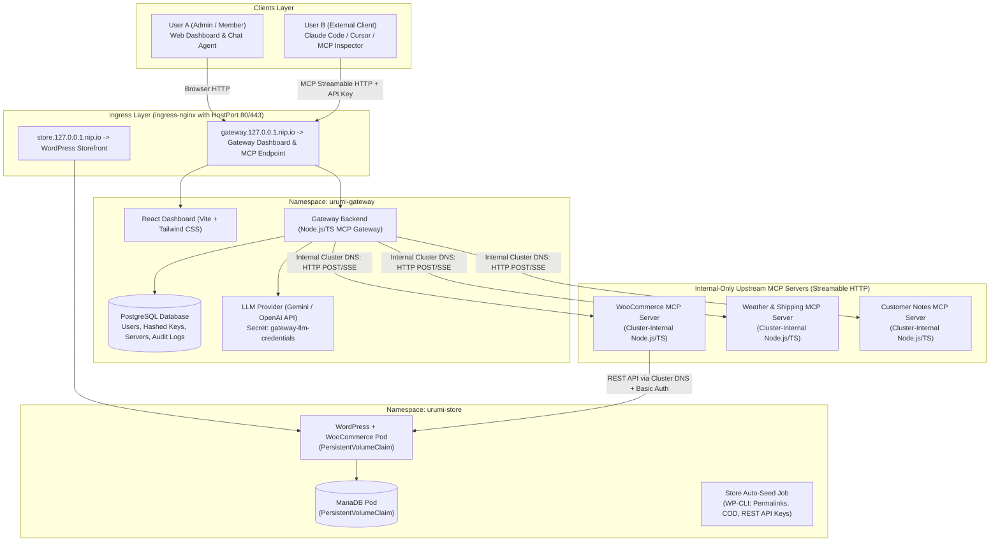

# Implementation Plan: WooCommerce Hosting with Team MCP Gateway on Kubernetes

## 1. Executive Summary & Objective

This project builds a multi-tier WooCommerce hosting platform featuring a centralized **Team MCP Gateway** deployed on Kubernetes using Helm. The platform enables administrators to register MCP servers once, exposing all aggregated tools through a single, secure MCP endpoint for external clients (Claude Code, Cursor, MCP Inspector) and through an embedded chat agent in a web dashboard.

The architecture is built from the ground up for zero-drift deployment across environments: identical Helm charts run on **local Kubernetes (Kind)** and **production-like VPS (k3s)**, configured purely through `values-local.yaml` and `values-prod.yaml`.

---

## 2. System Architecture & Isolation Model



### Architectural Principles & Boundaries
1. **Single Access Path:** Both external MCP clients and the in-dashboard chat agent access upstream tools exclusively via the Gateway. Neither the browser nor external clients ever connect to upstream MCP servers directly.
2. **Cluster-Internal Upstreams:** Upstream MCP servers run inside the Kubernetes cluster with ClusterIP services. No Ingress or external routes are configured for them.
3. **Official Streamable HTTP Specification:** Fully conforms to the Model Context Protocol Streamable HTTP transport specification:
   - Uses the official `@modelcontextprotocol/sdk` classes: `StreamableHttpServerTransport` (server) and `StreamableHttpClientTransport` (client).
   - Operates over a single unified endpoint (e.g., `/mcp`), where HTTP POST handles JSON-RPC request/response messages and HTTP GET initiates session-bound streaming. Does not assume legacy standalone `/sse` or `/message` path requirements.
4. **Deterministic Tool-Name Collision Handling:**
   - Standard namespacing format: `{server_prefix}_{tool_name}`.
   - Example mappings:
     - WooCommerce: `woocommerce_list_products`, `woocommerce_create_product`, `woocommerce_list_orders`, `woocommerce_get_order`, `woocommerce_update_order_status`.
     - Weather & Shipping: `weather_get_forecast`, `shipping_get_rates`.
     - Customer Notes: `customer_notes_save`, `customer_notes_get`.
   - The Gateway maintains an internal tool routing table mapping each prefixed tool to its upstream server, preventing namespace collisions.
5. **Upstream Fault Isolation:**
   - Each registered server has independent connection management, timeouts (5-second default), and error handling.
   - `tools/list` uses `Promise.allSettled()`. If an upstream is slow, dead, or pod-killed, other servers' tools remain listed and callable.
   - Server health is reported as `Connected`, `Unreachable`, or `Disabled`. Disabled servers have their tools omitted completely from active catalogs.
6. **Credential Security & SSRF Protection:**
   - User API keys are stored hashed (SHA-256). Every request checks revocation against PostgreSQL in real time.
   - Upstream credentials (Bearer tokens, Basic Auth) are stored encrypted in the database or K8s Secrets and injected server-side.
   - Upstream registration implements SSRF validation: rejects cloud metadata endpoints (`169.254.169.254`), host loopback ranges, and restricted cluster control-plane IPs.
7. **Comprehensive Audit Logging:**
   - Every tool call (from Chat Agent or external clients) records: `user_id`, `user_email`, `upstream_server`, `tool_name`, `timestamp`, `duration_ms`, `status` (`SUCCESS`/`ERROR`), and sanitized parameters.

---

## 3. Repository & Helm File Structure

```text
URUMI/
├── .gitignore
├── README.md                                  # Setup guide, DoD walkthrough, architecture notes
├── implementation_plan.md                     # This plan
├── docs/
│   ├── system-design-and-tradeoffs.md         # Architecture choices & tradeoffs note
│   └── threat-model.md                        # Threat model (shared credentials, SSRF, untrusted tools)
├── docker/
│   ├── woocommerce-mcp/
│   │   ├── Dockerfile
│   │   └── package.json
│   ├── mock-upstreams/
│   │   ├── Dockerfile
│   │   └── package.json
│   └── gateway/
│       ├── Dockerfile
│       └── package.json
├── src/
│   ├── woocommerce-mcp/                       # Custom WooCommerce MCP Server
│   │   ├── src/
│   │   │   ├── index.ts                       # Streamable HTTP server entry
│   │   │   ├── wc-client.ts                   # WooCommerce REST API v3 client
│   │   │   └── tools.ts                       # 5 required tools
│   │   ├── package.json
│   │   └── tsconfig.json
│   ├── mock-upstreams/                        # Upstream servers (Weather & Notes)
│   │   ├── src/
│   │   │   ├── weather-server.ts              # Weather & Shipping MCP (Streamable HTTP)
│   │   │   └── notes-server.ts                # Customer Notes MCP (Streamable HTTP)
│   │   ├── package.json
│   │   └── tsconfig.json
│   ├── gateway-backend/                       # Gateway & Aggregator Backend
│   │   ├── src/
│   │   │   ├── index.ts                       # Express / HTTP entry
│   │   │   ├── mcp/
│   │   │   │   ├── gateway-server.ts          # Streamable HTTP Gateway MCP Server
│   │   │   │   ├── upstream-manager.ts        # Client connections & health monitor
│   │   │   │   └── router.ts                  # Deterministic tool router
│   │   │   ├── db/
│   │   │   │   ├── index.ts                   # PostgreSQL / TypeORM / Kysely
│   │   │   │   └── migrations/
│   │   │   ├── auth/                          # Hashed API keys, RBAC (admin/member)
│   │   │   ├── audit/                         # Audit logger service
│   │   │   ├── security/                      # SSRF URL validator
│   │   │   └── agent/                         # LLM tool loop service (Gemini/OpenAI)
│   │   ├── package.json
│   │   └── tsconfig.json
│   └── dashboard/                             # React Dashboard UI
│       ├── index.html
│       ├── src/
│       │   ├── App.tsx
│       │   ├── components/
│       │   │   ├── ServersView.tsx            # Server list, status badge, tool view, add/edit modal
│       │   │   ├── TeamKeysView.tsx           # Member list, API key generator & revocation
│       │   │   ├── AuditLogsView.tsx          # Real-time searchable audit log table
│       │   │   └── ChatAgent.tsx              # Interactive agent with expandable tool execution chips
│       │   └── api/
│       ├── package.json
│       └── vite.config.ts
├── helm/
│   └── mcp-gateway/
│       ├── Chart.yaml
│       ├── values.yaml                        # Base defaults
│       ├── values-local.yaml                  # Kind / local configuration
│       ├── values-prod.yaml                   # VPS / k3s configuration
│       └── templates/
│           ├── _helpers.tpl
│           ├── namespaces.yaml
│           ├── ingress.yaml                   # Ingress for store and gateway
│           ├── secrets.yaml                   # Credentials (WC keys, LLM key, DB credentials)
│           ├── store/
│           │   ├── mariadb-statefulset.yaml
│           │   ├── mariadb-service.yaml
│           │   ├── wordpress-deployment.yaml
│           │   ├── wordpress-service.yaml
│           │   ├── store-pvc.yaml
│           │   └── store-init-job.yaml        # WP-CLI auto-setup job
│           ├── upstreams/
│           │   ├── woocommerce-mcp-deploy.yaml
│           │   ├── woocommerce-mcp-svc.yaml
│           │   ├── mock-upstreams-deploy.yaml
│           │   └── mock-upstreams-svc.yaml
│           └── gateway/
│               ├── postgres-statefulset.yaml
│               ├── postgres-service.yaml
│               ├── postgres-pvc.yaml
│               ├── gateway-deployment.yaml
│               └── gateway-service.yaml
└── scripts/
    ├── cluster-init.ps1                       # Kind cluster create + ingress-nginx
    ├── build-images.ps1                       # Build container images
    └── test-dod.ps1                           # Automated Definition-of-Done verification script
```

---

## 4. Phase-by-Phase Roadmap

### Phase 1: Cluster Bootstrap & Base Infrastructure (Current Step)
1. **Cluster Bootstrap:**
   - Verify Docker Desktop on Windows.
   - Create Kind cluster with host port mappings (`80:80`, `443:443`).
   - Install `ingress-nginx` via official Kind manifest.
   - Verify local DNS resolution via `127.0.0.1.nip.io`.
2. **Base Infrastructure:**
   - Define project namespaces: `urumi-store` and `urumi-gateway`.
   - Verify persistent volume provisioning via Kind's default `standard` storage class.
   - Establish K8s Secret management conventions.
3. **Helm Foundations:**
   - Scaffold the `helm/mcp-gateway` chart structure.
   - Create baseline `values.yaml`, `values-local.yaml`, and `values-prod.yaml`.
   - Deploy a lightweight test workload to verify Helm install, upgrade, and rollback capabilities.

### Phase 2: WooCommerce Store Layer & Automated Seeding
1. Deploy MariaDB StatefulSet with PersistentVolumeClaim in `urumi-store`.
2. Deploy WordPress + WooCommerce with persistent storage for `wp-content`.
3. Create the automated `store-init-job`:
   - Runs WP-CLI: checks WordPress installation.
   - Configures permalinks structure (required for WooCommerce REST API).
   - Activates WooCommerce and enables the Cash on Delivery (`cod`) gateway.
   - Creates a REST API key with Read/Write access.
   - Seeds initial sample products.
   - Stores the generated Consumer Key and Secret in a Kubernetes Secret (`wc-api-credentials`).
4. Configure Ingress to expose the store at `store.127.0.0.1.nip.io`.

### Phase 3: Custom WooCommerce MCP Server
1. Implement the server in Node.js/TypeScript using `@modelcontextprotocol/sdk` Streamable HTTP transport.
2. Implement WooCommerce REST API client connecting over cluster DNS:
   `http://wordpress.urumi-store.svc.cluster.local/wp-json/wc/v3`
3. Expose the 5 required tools:
   - `woocommerce_list_products(search?: string, category?: string, per_page?: number)`
   - `woocommerce_create_product(name: string, regular_price: string, description?: string, status?: string)`
   - `woocommerce_list_orders(status?: string, per_page?: number)`
   - `woocommerce_get_order(order_id: number)`
   - `woocommerce_update_order_status(order_id: number, status: string)`
4. Package into container and deploy to `urumi-store` (ClusterIP, probes, non-root).

### Phase 4: Additional Upstream MCP Servers
1. Implement **Weather & Shipping Rates MCP** (Streamable HTTP):
   - `weather_get_forecast(city: string)`
   - `shipping_get_rates(destination: string, weight_kg: number)`
2. Implement **Customer Notes & Memory MCP** (Streamable HTTP):
   - `customer_notes_save(customer_email: string, note: string)`
   - `customer_notes_get(customer_email: string)`
3. Deploy both with ClusterIP services in `urumi-gateway`.

### Phase 5: Team MCP Gateway Backend
1. **Upstream Manager & Aggregator:**
   - Connects to upstream servers via Streamable HTTP clients (`POST /mcp/message`, `GET /mcp/sse`).
   - Uses `Promise.allSettled()` to query tool schemas; tracks health (`Connected` / `Unreachable`).
   - Maps tools into unified catalog with deterministic namespacing.
2. **Streamable HTTP Gateway MCP Server:**
   - Exposes `/mcp/message` and `/mcp/sse`.
   - Authenticates requests via `Authorization: Bearer <api_key>`.
   - Validates key against SHA-256 hash in PostgreSQL; verifies user is not revoked.
   - Routes `call_tool` to the appropriate upstream, injecting upstream credentials server-side.
   - Wraps calls in timeouts; captures execution duration and status.
3. **Database & API:**
   - PostgreSQL schema: `users`, `api_keys`, `mcp_servers`, `audit_logs`.
   - Seed default Admin user (`admin@urumi.local`) and Member user (`member@urumi.local`).
   - Pre-seed the WooCommerce MCP server, Weather MCP, and Notes MCP.
   - REST API endpoints for server CRUD, key generation/revocation, audit log pagination.
   - SSRF validation on upstream URL updates.

### Phase 6: React Dashboard & Chat Agent
1. **Dashboard Interface:**
   - Built with Vite + React + Tailwind CSS (sleek dark theme).
   - **Servers:** View status, tool lists, enable/disable toggle, add/edit modal.
   - **Team & Keys:** Issue API keys (copy once modal), revoke keys, view user roles.
   - **Audit Logs:** Searchable, filterable table with real-time refresh.
2. **Integrated Chat Agent:**
   - Connects to Gateway with logged-in user context.
   - Implements agentic tool loop using Gemini or OpenAI API.
   - Displays real-time tool invocation cards (inputs, outputs, execution status).
   - All tool calls automatically logged in the audit log under the logged-in user.

### Phase 7: End-to-End Verification against Definition of Done
1. **Store:** Complete checkout using Cash on Delivery; verify order in WP admin.
2. **Chat Agent (User A):**
   - Create product via prompt -> verify on storefront.
   - Hand-place order -> prompt agent for today's orders -> verify accurate response.
3. **External MCP Client (User B):**
   - Connect Cursor / Claude Code / MCP Inspector using Gateway URL + User B API key.
   - Discover tools across all 3 servers.
   - Execute multi-server prompt (e.g. look up order and calculate shipping rates).
4. **Team & Control Validation:**
   - Revoke User B key -> verify immediate 401 Unauthorized rejection.
   - Disable 1 upstream server -> verify tools disappear from catalog.
   - Kill pod of 1 upstream server -> verify dashboard flags `Unreachable`, other servers continue working.
   - Verify audit log contains all transactions with correct user attribution.

### Phase 8: Documentation & VPS Readiness
1. Write comprehensive `README.md` with local Kind and VPS k3s deployment instructions.
2. Complete `docs/system-design-and-tradeoffs.md` and `docs/threat-model.md`.
3. Provide a structured demo video script for the walk-through recording.

---

## 5. Definition of Done Checklist

- [ ] Storefront loads, product can be added to cart and checked out with COD.
- [ ] Order visible in WooCommerce WP Admin.
- [ ] Chat agent (User A) creates product via tool call; product appears on storefront.
- [ ] Hand-placed order retrieved by chat agent.
- [ ] External client (User B) connects to single Gateway URL with API key.
- [ ] Tools from all 3 upstreams discovered by external client.
- [ ] Cross-server prompt executed successfully.
- [ ] User B key revoked -> next request rejected.
- [ ] Upstream server disabled -> tools removed from catalog.
- [ ] Upstream pod killed -> marked `Unreachable`, other servers unaffected.
- [ ] Audit log accurately captures all tool invocations with user, tool, duration, and status.
- [ ] Identical Helm charts deployable to Kind and k3s using values files.
